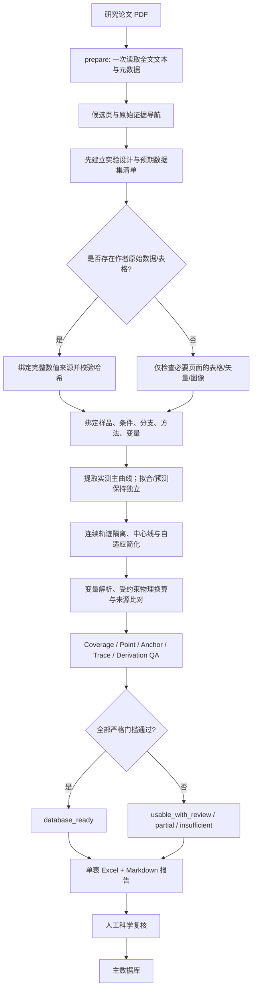

# UWC / SFCC Extractor


面向冻土与土体冻结研究论文的 **未冻水含量（Unfrozen Water Content, UWC）/ 土体冻结特征曲线（Soil Freezing Characteristic Curve, SFCC）提取 skill**。

它将论文 PDF 中分散在正文、表格、图像、图例、补充材料和数据仓库里的 UWC/SFCC 信息，整理为可审核的结构化数据，并输出一个单工作表 Excel 与一份精简 Markdown 报告。

> **发布定位：Human-Reviewed Production**
> 推荐工作流是 `PDF → 自动化/代理辅助提取 → Excel + 报告 → 人工科学复核 → 主数据库`。本项目不会把“程序运行成功”误报为“数据已经适合无人值守入库”。

## 目录

- [为什么需要它](#为什么需要它)
- [最新版做了什么](#最新版做了什么)
- [完整工作流](#完整工作流)
- [它是如何做到的](#它是如何做到的)
- [安装](#安装)
- [快速开始](#快速开始)
- [命令行接口](#命令行接口)
- [输入、内部数据与输出](#输入内部数据与输出)
- [质量控制与就绪状态](#质量控制与就绪状态)
- [项目结构](#项目结构)
- [测试与验证](#测试与验证)
- [已知限制](#已知限制)
- [开发原则](#开发原则)

## 为什么需要它

UWC/SFCC 数据提取并不是普通的“识别曲线坐标”。真实论文常见以下问题：

- 同一研究同时包含冻结、融化、拟合、预测和验证曲线；
- 设计条件出现在试验表中，曲线身份却只写在图例里；
- 图中有完整曲线，正文只列出少量验证值；
- `Su`、质量含水率 `wu` 和体积未冻水含量 `θu` 被混合使用；
- 最大干密度、试样干密度和相邻试验的密度容易被错误替代；
- 连续矢量路径可能共享局部线段、交叉、重叠或带有线宽重复坐标；
- “提取到所有曲线”不代表“提取到所有观测点”；
- 论文确实没有数值、数值被遮挡和提取失败是三种不同情况。

本项目的核心目标不是让表格看起来完整，而是让每个数值都能够回答：**它来自哪里、代表什么、是否完整、是否经过转换、为什么可以或不可以入库。**

## 最新版做了什么

当前优化版为 **UWC/SFCC Extractor v1.6.0-rc.1 — Safety-Gated Human-Reviewed Production**，新增的严格数据契约为 **schema/vocabulary 1.6.0**。1.0–1.5 数据仍可读取和导出；只有显式采用 1.6 的新提取才启用新增的强制门控。完整变更和发布边界见 [`references/release-v1.6.0-rc.1.md`](references/release-v1.6.0-rc.1.md)。

### vNext：从“提取完成”升级为“科学质量可证明”

本次优化针对曲线数量正确、但数值仍可能系统性偏高、冻融分支混线或被平滑表格掩盖的问题。改造不是加入某篇论文的修正规则，而是把通用证据链落实为可执行检查：

- **原始层与科学层分离**：`raw_trace_points` 保留检测候选，`uwc_points` 只保存经过隔离、校准和简化的科学曲线。QA 在插值、统一温度网格或平滑之前运行。
- **显式轴锚点**：1.6 的图像/矢量数字化不再接受“锚点数量=5”这样的自报字段作为充分证据；必须保存每个刻度的坐标、标签值和证据，并重新拟合、复算残差。
- **逐曲线数值 QA**：记录温度/UWC 范围、反向跳变、最大下降、最大局部斜率、初始含水率上限超出量和原始观测保留状态。
- **冻融配对 QA**：在相同试验条件下计算精确重复率、近重复率和分支相对顺序切换次数，识别共享候选、复制曲线和局部换枝。
- **曲线感知跟踪**：`branch_tracking.py` 以原始候选 ID、分支种子、二维路径连续性和切向连续性进行联合候选图分配；一个候选默认只能属于一个分支，证据不足的区段返回 unresolved，不生成插值点。
- **三层入库门控**：`detection_completeness`、`numerical_quality`、`physical_quality` 必须与来源、变量、元数据、轨迹处理等原门槛同时通过，`database_ready` 才能为真。

vNext 的安全原则是：低 MAE 不能抵消一个严重局部错误，100% 曲线覆盖也不能抵消分支身份不确定。任何强错误信号都会在 Excel 和 Markdown 中显式出现，并阻止数据库入库。

### Trace-resolution RC

本轮 RC 聚焦 raw candidate → isolation → branch ownership → centerline，不改动已经通过的轴校准、变量换算、来源优先级和默认单表 Excel：

- segment-level diagnostics 在 `.internal/trace_diagnostics` 中保存候选 ID、坐标、切向、竞争路径、失败原因、状态和温度范围；
- `joint_track_candidate_graph` 在二维路径图上联合分配 freezing/thawing，候选默认只能有一个 owner，只有显式 `confirmed_shared` 才允许共享；
- path-order centerline 保留 near-vertical multi-valued x，不再强制压成单值 `θ=f(T)`；
- accepted segment 的 raw-to-centerline P95 超过合同阈值时转为 unresolved，不再一边接受一边报告 fidelity failure；
- duplicate QA 分离 numerical equality、same candidate reuse、confirmed overlap 与 suspicious shared assignment；
- reverse-jump QA 可把 near-vertical path-order 伪跳变与真正下降分开；
- benchmark 新增 normalized point-to-polyline 与 symmetric curve distance，但这些离线人工指标不进入 production readiness。

### 1. 先建立实验设计清单，再提取曲线

系统从独立的试验表、图题和图例构建 `experimental_cases` 与 `expected_datasets`，再与提取结果比较。预期数量不再由“已经找到了多少条曲线”反推，因此缺失条件、分支或数据类型不会被悄悄忽略。

### 2. 区分科学语义与图形表现

最新版将两类信息拆开：

- `data_semantics`：measured、fitted、predicted、derived、unknown；
- `representation`：discrete markers、continuous measured trace、continuous model curve、table、explicit labels、equation 等。

因此，一条连续的 DSC 实验轨迹仍然可以是“实测数据”，不会仅因画成连续线就被误称为拟合曲线。

### 3. 区分方案点、已报告点与图中可见点

点完整性被拆分为：

- `protocol_expected`：试验计划或温度程序；
- `reported_expected`：论文明确报告的观测；
- `source_observable`：当前来源中可辨识的点。

只有有证据支持的硬分母才会用于缺点判断。协议温度列表不会自动变成“每条曲线都必须有这些点”的假设。

### 4. 连续曲线先隔离，再构建科学曲线

连续实测轨迹采用三层表示：

1. `raw_trace_points` 保存最大可恢复的原始几何坐标；
2. 曲线隔离与中心线阶段排除持续共享路径、外来局部偏移和不确定重叠；
3. `uwc_points` 保存经自适应简化后的科学曲线，用于 QA 与 Excel。

单点交叉不会被误判为污染；无法可靠分离的区段会保留为 review-required，而不是被猜测性修补。

连续曲线 QA 分别检查：

- 原始轨迹到中心线的正交距离；
- 中心线到简化科学曲线的重构误差；
- 陡峭相变区是否保留；
- 平坦低温尾部是否得到合理压缩；
- 后处理后的单调性；
- 接受、排除和未解决的几何区段。

默认中心线 P95 警告阈值为归一化坐标 `0.01`，默认简化重构容差为 `0.005`。超限不会篡改原始点，而是阻止自动入库。

### 5. 强化 UWC 变量与物理转换

系统显式区分 `Su`、体积含水量、干质量基含水量、归一化含水量、湿质量分数和未知变量。只有定义、单位、试样和适用条件都得到证据支持时才执行物理换算，例如：

```text
θu = φ × Su
θu = wu × ρd / ρw
```

其中：

- `Su → θu` 必须有已核实的孔隙体积定义和适用孔隙率；
- `wu → θu` 必须使用实际 UWC 试样的干密度；
- 最大干密度不能冒充试样干密度；
- 来源不明确、角色冲突或条件不匹配时保留原变量，不强制换算；
- 真正的物理推导保留输入、公式、单位、假设和证据，普通单位缩放不伪装成科学推导。

### 6. 引入有界缺失曲线恢复

导出时只允许一次针对缺失 manifest 项的定向恢复：

- 优先匹配经验证的完整数值数据集；
- 支持带 SHA-256、工作表、行列范围和单位绑定的 XLSX/CSV/TSV；
- 少量 anchors 不能冒充完整曲线；
- 分支、循环、变量、条件和方法必须一致；
- 同优先级来源冲突时不自动选择、不平均；
- 未找到时返回 `targeted_review_required`，不会全篇重跑或生成假点。

### 7. 更严格、也更诚实的就绪状态

`paper.review_status` 描述人工工作可用性：

| 状态 | 含义 |
| --- | --- |
| `database_ready` | 所有严格自动入库门槛均通过 |
| `usable_with_review` | 数据可辨识，但仍需来源、冲突或完整性审核 |
| `partial` | 存在可用子集，同时存在真实缺失、不可用目标或不完整清单 |
| `insufficient` | 尚无语义、变量、分支和证据都足够明确的数值子集 |

`review_status` 不能覆盖 `database_ready`。人工“已查看”也不能消除缺曲线、错误变量或无效转换。

### 8. 输出更适合真实审阅

默认仅生成两个用户可见文件：

- `PAPER_ID_UWC.xlsx`
- `PAPER_ID_report.md`

Excel 只包含一个 `UWC_SFCC` 工作表，按以下四区组织：

1. Paper Information
2. Basic Soil Properties
3. Test Conditions
4. UWC/SFCC Data

曲线以相邻的 `Temp–UWC` 两列成对展示，每个横向 band 最多四组，按实验因素和土样分组。内部 ID、校准坐标与原始几何不会污染面向审阅者的表格。

## 完整工作流



## 它是如何做到的

### 分层架构

| 层 | 主要模块 | 职责 |
| --- | --- | --- |
| PDF 准备 | `scripts/uwc.py` | 读取 PDF 文本、哈希、元数据与候选页；按需检查选定页 |
| 几何提取 | `scripts/geometry.py` | 坐标轴标定、marker 中心、矢量路径、单值 raster trace、自适应采样 |
| 曲线隔离 | `scripts/curve_isolation.py` | 识别共享路径、外来局部轨迹与不确定重叠 |
| 轨迹处理 | `scripts/trace_processing.py` | 中心线、局部去噪、相变保护、简化与双阶段误差统计 |
| 语义与设计 | `scripts/semantics.py`, `design.py`, `manifest.py` | 科学语义、实验设计、预期曲线与点清单 |
| 来源解析 | `scripts/sources.py` | 数值来源绑定、缺失曲线定向恢复、anchors 与来源选择 |
| 科学换算 | `scripts/science.py`, `conversion.py` | 单位规范化、变量换算、属性角色与推导溯源 |
| 覆盖与质量 | `scripts/coverage.py`, `quality.py`, `hardening.py` | 曲线覆盖、点完整性、科学门槛、review queue 与就绪状态 |
| 人类输出 | `scripts/presentation.py`, `reporting.py` | 单表 Excel 和紧凑 Markdown 审阅报告 |
| 数据契约 | `schemas/` | JSON Schema 1.6.0（向后兼容 1.0–1.5）与受控词汇表 |

### 来源优先级

对于同一组观测，默认优先级为：

```text
作者原始/补充数据
  > 表格
  > 印刷数值标签
  > 正文明确数值
  > 图中离散 marker
  > 连续曲线追踪
```

高精度的少量验证值不会替代覆盖更完整的主曲线。精确值可以控制相同观测位置的最终显示，但原始图形点仍被保留；冲突来源不会被平均。

### 三层语言模型

项目同时维护三种信息层：

| 层 | 示例 | 规则 |
| --- | --- | --- |
| 原始证据 | `soil_type_reported: "兰州黄土"` | 原文逐字保留 |
| 规范科学语义 | `soil_type_normalized: "loess"` | 仅在证据支持时赋值 |
| 人类展示 | `display_label_zh: "黄土"` | 仅用于显示，不参与匹配与推断 |

内部字段与枚举使用稳定的英文 `lower_snake_case`。原始标题、作者、图题、图例、公式和引文不会被翻译覆盖。

## 安装

### 1. 获取代码

```bash
git clone <your-repository-url>
cd uwc-sfcc-extractor
```

### 2. 创建环境并安装依赖

```bash
python -m venv .venv
```

Windows PowerShell：

```powershell
.venv\Scripts\Activate.ps1
python -m pip install -r requirements.txt
```

Linux/macOS：

```bash
source .venv/bin/activate
python -m pip install -r requirements.txt
```

核心依赖包括 PyMuPDF、jsonschema、openpyxl、NumPy、Pillow 与 SciPy。

### 3. 作为 Codex skill 安装

将整个 `uwc-sfcc-extractor` 目录复制到：

```text
$CODEX_HOME/skills/uwc-sfcc-extractor/
```

随后可在 Codex 中使用：

```text
使用 $uwc-sfcc-extractor，从这些 PDF 中提取可审核的 UWC/SFCC 数据。
```

## 快速开始

以下命令展示底层生产流程。实际科学语义识别、实验清单建立和图例绑定由 agent/研究者结合原文完成。

### 1. 准备论文包

```bash
python scripts/uwc.py prepare \
  --pdf papers/example.pdf \
  --paper-id Example2026 \
  --out results
```

生成：

```text
results/Example2026/
└── .internal/
    ├── candidates.json
    └── Example2026_UWC.json
```

`prepare` 只做一次全文文本读取、来源哈希和候选导航，不会把关键词命中直接当作科学结论，也不会声称已经完成曲线提取。

### 2. 仅检查必要页面

```bash
python scripts/uwc.py inspect results/Example2026 \
  --pages 5 9 \
  --tables \
  --vectors
```

只有确实需要视觉或 raster 检查时才使用 `--render`：

```bash
python scripts/uwc.py inspect results/Example2026 --pages 9 --render
```

生产模式不会默认渲染全篇、创建 overlay 或运行 benchmark。

### 3. 编辑内部数据集

依据 `candidates.json`、原文证据和选定页结果，完善：

```text
results/Example2026/.internal/Example2026_UWC.json
```

应先记录实验设计与 `expected_datasets`，再写入曲线和点；不要用已提取曲线反推预期数量。

### 4. 导出并自动执行 QA

```bash
python scripts/uwc.py export \
  results/Example2026/.internal/Example2026_UWC.json \
  --out results/Example2026
```

输出：

```text
results/Example2026/
├── Example2026_UWC.xlsx
├── Example2026_report.md
└── .internal/
    ├── candidates.json
    └── Example2026_UWC.json
```

`export` 已包含 schema validation、物理转换、一次有界恢复、QA、Excel 与报告生成。正常流程不需要先单独运行 `validate`。

## 命令行接口

```text
python scripts/uwc.py prepare  --pdf PDF --paper-id ID --out ROOT
python scripts/uwc.py inspect  PACKAGE --pages N [N ...] [--tables] [--vectors] [--render]
python scripts/uwc.py validate DATASET
python scripts/uwc.py recover  DATASET
python scripts/uwc.py export   DATASET --out PACKAGE
```

| 命令 | 用途 |
| --- | --- |
| `prepare` | 创建独立论文包、缓存全文文本、记录 PDF SHA-256 与候选页 |
| `inspect` | 对选定页面执行表格、矢量或渲染检查 |
| `validate` | 诊断编辑后的内部 JSON，不生成用户输出 |
| `recover` | 对缺失 manifest 项执行有界定向恢复并更新内部 JSON |
| `export` | 执行最终转换、QA，并生成 Excel 与 Markdown |

所有命令默认为 `--mode production`。`benchmark` 仅用于开发诊断，不应混入普通论文提取。

## 输入、内部数据与输出

### 输入

- 可读取、未加密的研究论文 PDF；
- 论文明确链接的补充数据或作者原始数据；
- 必要时，由研究者确认的图例、坐标轴和试验条件绑定。

### 权威内部数据

内部 JSON 采用以下主结构：

```text
Paper
├── Samples
│   ├── Soil Properties
│   └── Conditions
│       └── Curves
│           ├── UWC Points
│           └── Raw Trace Points
├── Evidence
├── Numerical Sources / Anchors
├── Derivations
└── Review Queue
```

JSON 是权威科学记录；Excel 是供人审阅的紧凑视图。无法安全装入 Excel 的原始字符串、证据绑定、校准与几何细节仍保留在 `.internal/` 中。

### Excel

- 单一 `UWC_SFCC` 工作表；
- 原始论文信息、土体性质、紧凑试验设计和曲线数据；
- 冻结/融化、实测/拟合/预测、独立重复分别展示；
- 温度与 UWC 成对，不拆散原始数值配对；
- 保留点序与重复温度，不插值、不默认重采样；
- 报告值精度与数字化曲线显示精度独立保存。

### Markdown 报告

报告聚焦：

- 论文与提取摘要；
- UWC/SFCC 来源；
- 变量定义和换算；
- 跨来源验证；
- 冲突与说明；
- 需要人工处理的 Critical / Important 项。

重复逐点警告会按曲线聚合，安全保留的非关键术语不会制造无意义的审阅任务。

## 质量控制与就绪状态

`database_ready: true` 至少要求以下七类门槛全部通过：

1. 有证据支持的预期曲线与提取曲线身份一致；
2. 没有无法解释的硬点缺口，并已完成来源完整性检查；
3. 没有未解决的显著数值来源冲突或不可用绑定；
4. 原始变量与物理换算有效；
5. 论文、材料、方法、分支、条件和相关性质可识别；
6. 连续实测轨迹通过中心线 fidelity 与科学曲线 reconstruction QA；
7. 物理换算具有已核实的样品、条件与试样适用性。

此外不能存在未关闭的 Critical 问题。

以下做法**不会**让数据自动变为可入库：

- 仅达到 100% 曲线覆盖率；
- 用拟合曲线补齐缺少的实测曲线；
- 用少量精确 anchors 代替完整主曲线；
- 把协议温度列表当成已报告点；
- 把 NMR proxy signal 当成未经支持的 UWC；
- 将最大干密度用于试样体积含水量换算；
- 将 Critical 标记为“已看过”，但没有解决其科学原因。

## 项目结构

```text
uwc-sfcc-extractor/
├── SKILL.md                    # Skill 入口与生产工作流
├── README.md                   # GitHub 项目说明
├── LICENSE                     # MIT 代码许可证
├── CONTRIBUTING.md             # 贡献与测试要求
├── SECURITY.md                 # 安全问题报告方式
├── DATA_AND_COPYRIGHT.md       # 论文与提取数据的版权边界
├── requirements.txt            # Python 依赖
├── .github/                    # CI、Issue 和 PR 模板
├── agents/
│   └── openai.yaml             # Agent 展示与默认提示词
├── references/
│   ├── data-contract.md         # 数据契约
│   ├── extraction.md            # 提取范围与来源优先级
│   ├── digitization.md          # 按需数字化规则
│   ├── hardening.md             # 证据、恢复与 readiness 门槛
│   ├── language-policy.md       # 原文/规范语义/显示语言策略
│   ├── implementation-status.md # 实现边界
│   ├── release-v1.0.md          # v1.0 发布说明
│   ├── release-v1.6.0-rc.1.md   # 当前 RC 发布说明
│   └── v1.1-backlog.md          # 基于真实重复失败的后续证据池
├── schemas/
│   ├── paper.schema.json        # Schema 1.6.0
│   └── vocabulary.json          # Vocabulary 1.6.0
├── scripts/                     # 提取、科学处理、QA 与输出模块
└── tests/                       # 合成单元/集成测试；私有论文 fixture 不随仓库发布
```

## 测试与验证

运行公开测试套件：

```bash
python -m unittest discover -s tests -v
```

公开仓库验证结果：

```text
Ran 180 tests
OK (skipped=22)
```

其中 158 项合成与契约测试在公开 CI 中执行；22 项依赖真实论文记录的回归测试保留测试定义，但因对应 fixture 未公开而明确跳过。维护者的私有发布验证为 180/180 通过。二者必须分开陈述，不能把未公开 fixture 的结果伪装成第三方可复现的公开测试。

覆盖范围包括：

- 线性、反向线性与正对数坐标轴标定；
- marker、矢量路径与连续 raster trace；
- 设计清单、缺失/意外/重复曲线检测；
- 冻结/融化、循环、实测/拟合/预测隔离；
- 精确 anchors、来源优先级和冲突保护；
- Su、质量含水率与体积含水率转换；
- 最大干密度与试样干密度角色隔离；
- 连续曲线隔离、中心线 fidelity 与自适应简化；
- 原始证据、中文/日文字符串与 Excel 往返保持；
- 单工作表输出、配对曲线布局和报告审阅状态；
- 公开合成回归，以及维护者环境中的记录论文非回归行为。

测试通过证明软件行为符合当前契约，不代表任意新论文都无需人工语义判断，也不等同于独立数字化精度验证。

## 已知限制

- 图例、曲线身份、变量定义和试样适用性仍需要 agent/研究者依据原文判断；
- 重叠曲线、共享连续路径、低分辨率图和模糊分支可能需要人工复核；
- 不确定区段会被排除或标为 unresolved，不会自动补线；
- 无法核实的 UWC 基准将保持 `unknown`，不会根据数值大小猜测；
- 论文没有公开数值时，本项目不会从 proxy signal 发明 UWC；
- 当前版本不承诺完全无人值守数据库导入；
- 历史 benchmark 与 fixture 是开发证据，不应被宣传为所有文献上的普遍精度或速度结论。

## 开发原则

v1.0 生产逻辑已经冻结。维护遵循以下原则：

- 不为单篇异常论文增加 paper-specific 规则；
- 只有失败严重且显然具有通用性，或同类失败在多篇独立论文中重复出现，才考虑修改生产逻辑；
- 新问题先记录到 [`references/v1.1-backlog.md`](references/v1.1-backlog.md)；
- 任何变更都必须保护原始证据、现有数值、推导来源和已通过 fixture；
- 不通过隐藏 Critical、缩小分母或放宽科学定义来提高通过率。

详细契约与实现边界参见：

- [`SKILL.md`](SKILL.md)
- [`references/release-v1.6.0-rc.1.md`](references/release-v1.6.0-rc.1.md)
- [`references/release-v1.0.md`](references/release-v1.0.md)
- [`references/data-contract.md`](references/data-contract.md)
- [`references/hardening.md`](references/hardening.md)
- [`references/implementation-status.md`](references/implementation-status.md)

---

代码采用 [MIT License](LICENSE)。论文 PDF、出版商文本、提取数据与用户生成结果不因代码开源而自动获得 MIT 授权，详见 [DATA_AND_COPYRIGHT.md](DATA_AND_COPYRIGHT.md)。贡献方式见 [CONTRIBUTING.md](CONTRIBUTING.md)，安全问题请按 [SECURITY.md](SECURITY.md) 私下报告。
